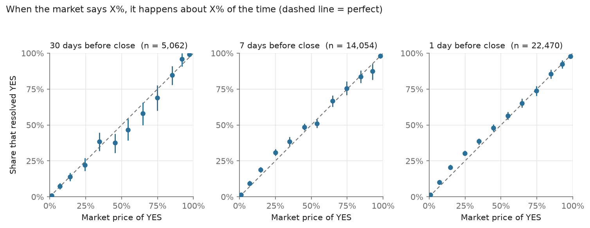
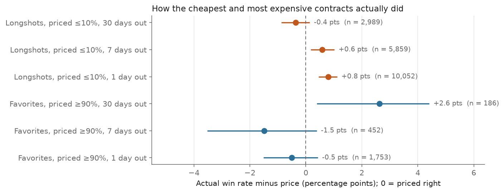

# Fair Odds

**Do prediction-market prices mean what they say?** When Polymarket prices something at 30%, does it happen about 30% of the time? A calibration study of **22,625 resolved Polymarket yes/no markets** from 11,923 events, almost all ending between January 2024 and November 2026.



## Findings

| Question | Answer |
|---|---|
| Are the prices calibrated? | **Mostly, yes.** Miscalibration is under 1% of the Brier score at every horizon (reliability 0.0008–0.0009 vs. a Brier score of 0.08–0.13). |
| How much does accuracy improve as the end nears? | On the same 4,834 markets, the Brier score falls from **0.081** at 30 days out to **0.059** at 7 days and **0.045** at 1 day. |
| Is there a bias? | In the last week, yes, and it's small. Contracts priced 5–40% happened **3.0 points** (7 days out, 95% interval 1.7–4.4) and **3.7 points** (1 day out, 2.7–4.8) more often than their price, on markets where the snapshot time can't depend on the outcome. Thirty days out there's no gap (−0.5 points, −2.6 to +1.6). |
| The classic favorite–longshot bias? | Not here. Contracts priced 10% or less won slightly *more* often than priced (+0.6 points 7 days out, 0.2–1.0), not less. |
| Could you beat the market with a simple correction? | **No.** A correction fitted on 2024–25 markets made 2026 forecasts no better: Brier 0.15297 vs. 0.15286 for the raw prices (difference −0.0001, interval −0.0009 to +0.0006). The pattern isn't stable enough over time to trade on. |

Calibration slope by category (7 days out, 1.00 = calibrated): politics 0.95, sports 0.95, crypto 0.96, tech & culture 0.97, economy 0.90. Every category's interval includes 1, so no category stands out.



## Method

1. **Markets** (`scripts/fetch_markets.py`): every closed Polymarket event with at least $50,000 traded, month by month from the public Gamma API. Kept: plain yes/no markets that resolved cleanly to 1 or 0, with at least $50,000 traded in the market itself. 61,427 markets.
2. **Prices** (`scripts/fetch_prices.py`): the daily price of YES from the public CLOB API, for a stable 40% sample chosen by a hash of each market's ID (so a refresh keeps the same markets). 24,473 downloaded; 22,625 have a usable price at one or more horizons.
3. **Snapshots** (`src/pmcal/dataset.py`): the last price at or before 1, 7, and 30 days before the market's **anchor time**, if that price is at most 48 hours old.
4. **Statistics** (`src/pmcal/stats.py`): calibration bins, the Brier score and its Murphy decomposition, a calibration slope (logistic regression of the outcome on the log-odds of the price), and 95% intervals from a **cluster bootstrap that resamples whole events**: in a 20-candidate election exactly one market resolves YES, so markets in an event aren't independent.

### Two traps, and what I did about them

- **Prices that already know the answer.** A market's recorded close can come hours or days after the result was known (a game ends, the market is resolved the next day). So the anchor is the *earlier* of the scheduled end and the recorded close.
- **Snapshot timing that depends on the outcome.** For "Will X happen *by* June 30?", a YES usually arrives early and a NO waits for the deadline, so a "1 day before close" snapshot lands at different points depending on how it resolved. Over all markets, contracts priced 5–40% happened 4.2 (7 days out) to 4.8 points (1 day out) more often than priced. Restricting to markets that resolved on schedule and aren't by-a-date questions (77% of markets), the gap shrinks by about a quarter, to 3.0–3.7 points, but holds. The table above uses that stricter subset for the gap.

## Limits

- **Daily prices.** For closed markets the price-history endpoint only returns daily points, so "1 day out" means the last daily price at least 24 hours before the anchor.
- **Last prices, not quotes.** The price is the last trade, not something you could necessarily buy at. The return figures in `results/metrics.json` ignore spreads and fees and are there for scale, not as a strategy.
- **Liquid markets only.** Markets under $50,000 traded are left out, so this says nothing about thin markets.
- **One platform**, with heavy growth in sports markets in 2026 (60% of snapshots are from 2026).

## Run it

```bash
python -m venv .venv && .venv/Scripts/activate      # macOS/Linux: source .venv/bin/activate
pip install -e ".[dev]"
python scripts/fetch_markets.py        # ~45 minutes; writes data/markets.csv
python scripts/fetch_prices.py --share 0.4   # ~20 minutes; data/prices/
python scripts/build_dataset.py        # data/dataset.csv (committed, so you can start here)
python scripts/analyze.py              # results/metrics.json
python scripts/charts.py               # results/*.png
pytest                                 # 8 tests
```

Data: Polymarket's public Gamma and CLOB APIs (no account or key). This is a study of forecasting accuracy, not betting advice.
